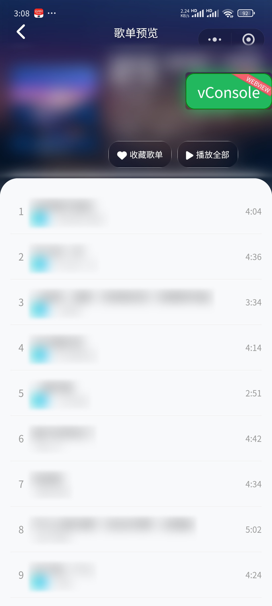
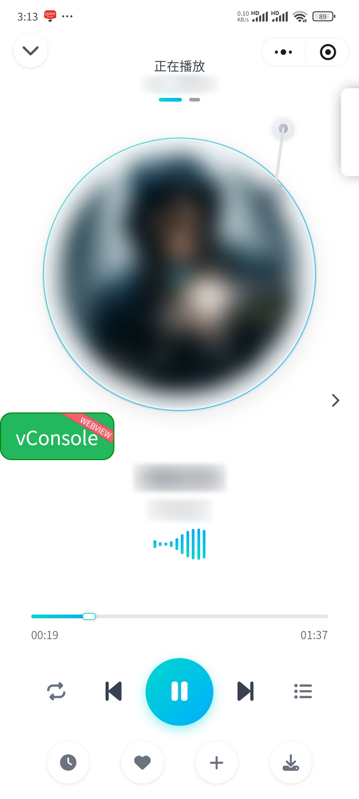
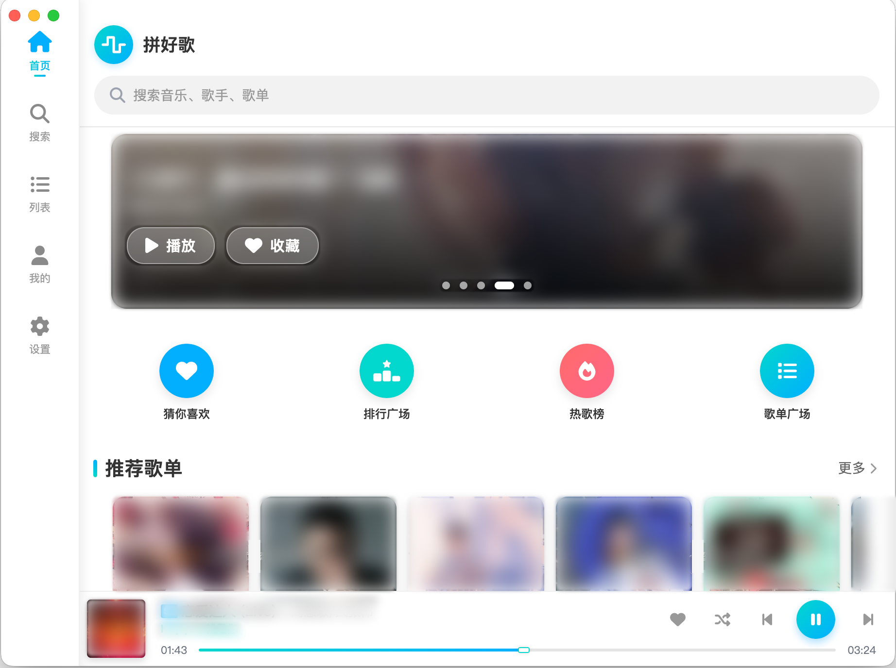
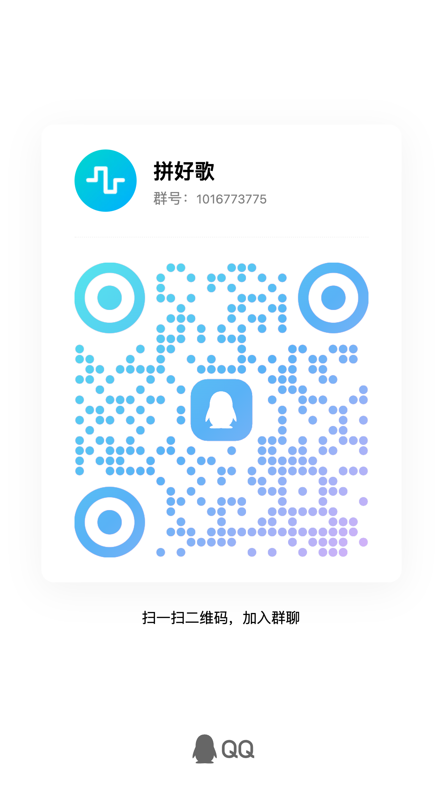

    
  

# 拼好歌 (phgmusic)

一款跨平台音乐播放器工具 · 支持鸿蒙/iPhone/Android/windows/mac/linux

## ✨ 项目简介

"拼好歌"是一款面向技术爱好者的个人跨平台音乐播放器工具，兼容洛雪音乐音源插件脚本生态（小部分不兼容），部分功能的实现思路参考开源项目 LX Music（洛雪音乐，Apache-2.0 许可）。应用提供完整的播放控制、歌单管理、数据同步、定时关闭、后台播放、暗黑模式等功能，界面简洁无广告。项目代码开源，仅供技术学习与交流使用。

## 🌐 官网

文档、教程与下载都在官网，域名长期有效，仓库地址变动也会在站内更新。两个地址内容一致，任选其一：

| 站点  | 地址                                                         |
|:--- |:---------------------------------------------------------- |
| 官网  | [home.pinhaoge.dynv6.net](https://home.pinhaoge.dynv6.net) |
| 备用  | [phgmusic.pages.dev](https://phgmusic.pages.dev)           |

## 🔗 关联项目

**拼好歌后端服务器（Cloudflare Workers + D1）** - [cf\_phg\_music\_server](https://codeberg.org/erikjamesgz/cf_phg_music_server)

- 免费套餐 10 万次/天，可部署在自己的 Cloudflare 账号下
- 账号体系、数据同步、音源插件沙箱与管理后台都在这里

> 客户端与服务端的仓库地址统一维护在官网[代码仓库](https://home.pinhaoge.dynv6.net/guide/repos)页面，托管平台可能变动，以该页为准。

## 📸 应用截图

| 首页                                                                      | 歌单详情页                                                                      | 播放器                                                                      |
|:-----------------------------------------------------------------------:|:--------------------------------------------------------------------------:|:------------------------------------------------------------------------:|
|  |  |  |

| 桌面端/平板模式                                                |
|:-------------------------------------------------------:|
|  |

## 📦 更新日志

| 版本          | 主要更新                                                                                                                                                                                                      |
| ----------- | --------------------------------------------------------------------------------------------------------------------------------------------------------------------------------------------------------- |
| **v2.0.0**  | 新增**本地运行音源插件**模式（Android / Windows / macOS / Linux）（部分功能需搭配最新版服务器） 新增**桌面端自动升级**（Windows / macOS / Linux） 新增**切歌防连点**、**播放失败自动重试**、**停止播放原因提示** 优化大歌单卡顿 修复音质标识与实际不符等问题 修复若干小 bug |
| **v1.0.20** | 新增**账号体系与数据同步**（邮箱登录、云同步、本地备份恢复） 新增**音源插件本地导入** 新增**优先播放音质** 修复若干问题                                                                                                                        |
| v1.0.11     | 新增**听歌识曲**功能（需搭配最新版服务器） 修复 AI 推荐歌曲重复率过高 修复鼠标右键不能粘贴 修复若干小 bug                                                                                                                               |
| v1.0.10     | 新增**节点互联**（服务器对外提供）功能 修复若干 bug 修复部分样式问题                                                                                                                                                         |
| v1.0.09     | 新增 **AI 推荐歌曲**功能（需搭配最新版服务器） 修复首页 banner 异常滑动 修复换源异常 修复 Android 客户端升级异常 修复部分设备 APP 后台运行后无法切换歌曲 修复部分样式问题                                                                           |
| v1.0.08     | 正式发布；桌面 / 平板宽屏模式适配（迷你播放器、日夜模式），适配微信小程序平板模式                                                                                                                                                                |
| v1.0.07     | 新增脚本源成功率统计与当前脚本源提示 修复 Android 状态栏切换歌曲异常 修复歌单播放数据同步 修复网页版显示异常                                                                                                                               |
| v1.0.06     | 大版本更新，修复若干 bug                                                                                                                                                                                            |
| v1.0.05     | 修复歌词显示异常、歌单预览加载速度、英文歌曲中文翻译 适配 iOS / Android 页面 新增关闭省电模式、异常退出后记录播放进度                                                                                                                             |
| v1.0.03     | 新增评论弹幕功能、新版本提示功能 优化首页                                                                                                                                                                                |
| v1.0.0      | 首个版本：初始化拼好歌移动端项目                                                                                                                                                                                          |

## 🚀 快速开始

**下载客户端**：[官网下载页](https://home.pinhaoge.dynv6.net/download) · [备用下载页](https://phgmusic.pages.dev/download) · [发布页](https://codeberg.org/erikjamesgz/phg-music/releases)（Android / Windows / macOS / Linux 安装包；iOS 与华为纯血鸿蒙需用微信开发者工具编译小程序运行）

完整步骤写在官网教程里，本文档不再重复：

| 要做的事                        | 教程                                                         |
|:--------------------------- |:---------------------------------------------------------- |
| 安装客户端、选择服务器模式、导入音源插件        | [客户端使用教程](https://home.pinhaoge.dynv6.net/guide/client)    |
| 部署自己的后端（Cloudflare Workers） | [服务端部署教程](https://home.pinhaoge.dynv6.net/guide/deploy)    |
| 音源插件的支持范围与脚本写法              | [音源插件使用教程](https://home.pinhaoge.dynv6.net/guide/plugin)   |
| 各平台运行方式与当前限制                | [平台与运行模式](https://home.pinhaoge.dynv6.net/guide/platforms) |

### ⚠️ 重要说明

- ❌ **本项目不提供任何音乐内容与在线服务**，只提供播放能力，后端服务器需自行部署
- ❌ **不提供任何音源插件脚本**，也不提供脚本的修改与定制服务
- ✅ **支持洛雪音乐音源插件脚本生态**，小部分不兼容，混淆过的脚本可能不支持
- ⚠️ **音源插件由使用者自行提供**，请自行确认来源与授权合法合规，本项目不对第三方脚本的内容与行为负责
- 💡 **建议导入 2-3 个音源插件**，播放时自动切换到可用插件
- 💡 **公共服务器模式下，音源插件仅保存在本地**，不会上传到服务器

## 📱 功能模块

| 模块         | 主要功能                                                                 |
|:---------- |:-------------------------------------------------------------------- |
| 🏠 首页      | 轮播推荐、猜你喜欢、排行榜广场、歌单广场、推荐歌单、新歌速递                                       |
| 🎤 听歌识曲    | 麦克风录音与内部音频识别，保留最近识别记录，识别结果可直接播放                                      |
| 🔍 搜索      | 多音源插件聚合搜索（歌曲 / 歌单 / 歌手 / 专辑）、搜索历史、热搜榜、搜索建议                           |
| 🎵 播放器     | 全屏与迷你双形态、四种播放模式、歌词同步、收藏，展示音源插件；播放失败自动换源重试，缓存地址失效自动刷新，不支持格式自动跳过       |
| 📋 播放列表    | 试听列表、我的收藏、播放历史、自定义歌单，支持歌单导入导出                                        |
| 📊 排行榜     | 各平台热歌榜、新歌榜、飙升榜与分类排行                                                  |
| 🎨 歌单广场    | 精选推荐、分类浏览、歌单详情预览                                                     |
| 🤖 AI 推荐   | 个性化推荐、推荐偏好（场景 / 探索度 / 年代 / 语言）、音乐画像卡片，可接入第三方 AI 服务                   |
| 👤 我的      | 听歌统计（歌曲数、累计与今日时长、最爱歌手）、贡献成就、我的歌单与收藏                                  |
| 🔐 账号与数据同步 | 邮箱登录（邀请码注册）、设备管理、云同步（间隔可调）、本地备份与恢复、配置导入导出；云同步需登录专属服务器                |
| ⚙️ 设置      | 服务器地址与连通测试、优先播放音质、音源插件管理（在线 / 本地 / Raw 导入、编辑、默认源）、主题（暗黑 / 跟随系统）、定时停止 |

## 📝 开源说明

### 开源协议

本项目基于 [Apache License 2.0](LICENSE) 许可证发行，以下协议是对于 Apache License 2.0 的补充，如有冲突，以以下协议为准。

<!-- 协议正文真源：components/common/pactContent.js —— App 内签署/展示与本节为同一份文本。改此处必须同步该文件，反之亦然。 -->

#### 词语约定

本协议中的“本项目”指“拼好歌”客户端项目及其关联的开源代码仓库；“开发者”指本项目的代码贡献者和发布者；“使用者”指签署本协议并使用本项目的任何人；“部署者”指自行部署本项目代码、并自愿将服务器资源提供给其他使用者的运营者；“音源插件”指由第三方编写、使用者自行导入的 JavaScript 插件；“官方音乐平台”指各音乐源的官方平台统称；“版权数据”指包括但不限于图像、音频、名字等在内的他人拥有所属版权的数据。

#### 一、数据来源

1.1 **开发者角色声明**：本项目为开源软件，开发者仅以个人名义发布源代码，代码托管在 Codeberg。开发者**不运营任何在线服务**，不控制、不监督任何用户自行部署的服务器实例，不提供、不存储、不传输任何音乐内容或音源插件。

1.2 **数据来源说明**：本项目展示的在线数据（如搜索结果、歌单信息等）全部来自使用者连接的服务器（包括使用者自行部署的专属服务器或社区部署者提供的公共服务器）返回的数据。本项目的客户端仅作为播放器和工具，将使用者请求的歌曲信息传递给服务器，并展示服务器返回的结果。

1.3 **音源插件说明**：本项目**不提供任何音源插件**，音源插件由使用者自行搜索、评估、导入和使用。音源插件的作者、来源、行为均与本项目开发者无关。本项目仅提供执行音源插件的框架，不对音源插件的行为负责。

1.4 **数据准确性**：由于本项目不对服务器返回的数据进行合法性校验，使用过程中可能会出现希望播放的音频与实际播放的音频不对应或无法播放的问题，本项目及开发者不对此负责。

#### 二、版权数据

2.1 使用本项目的过程中可能会产生版权数据。对于这些版权数据，本项目不拥有它们的所有权。使用者的清除义务见 6.2。

#### 三、资源使用

3.1 本项目内使用的部分包括但不限于字体、图片等资源来源于互联网。如果出现侵权可联系本项目移除。

#### 四、免责声明

4.1 **开发者免责**：开发者不对使用者或部署者使用本项目的方式、目的和后果承担任何责任。开发者不保证本项目符合任何特定国家或地区的法律法规，使用者有义务在使用前确认其所在地的法律要求。

4.2 **部署者免责**：部署者自愿开放其自行部署的服务器资源，此行为完全基于自愿且非商业性质。部署者仅提供服务器资源（CPU、网络带宽等基础设施），**不提供、不存储、不缓存、不传输任何音乐内容**。部署者服务器执行的音源插件由使用者自行提供，部署者不知道、无法预知也无法控制音源插件的具体行为，不对音源插件可能产生的任何后果负责。

4.3 **损害责任**：由于使用本项目（包括但不限于客户端、服务器、音源插件）或无法使用本项目而引起的任何性质的任何直接、间接、特殊、偶然或结果性损害（包括但不限于因商誉损失、停工、计算机故障或故障引起的损害赔偿，或任何及所有其他商业损害或损失）均由使用者自行承担。

4.4 **数据责任**：本项目及开发者、部署者不对通过本项目获取的任何数据的合法性、准确性、完整性负责。使用者应自行判断数据来源的合法性和适用性。

4.5 **第三方内容**：本项目可能访问或展示第三方网站或服务的内容，开发者及部署者不对这些第三方内容的合法性、准确性或可用性负责。

#### 五、使用限制

5.1 **技术学习用途**：本项目完全开源、不收取任何费用，面向全世界人用作技术学习和交流。开发者不对项目内的技术可能存在违反当地法律法规的行为作保证。

5.2 **遵守法律法规**：禁止在违反当地法律法规的情况下使用本项目（包括客户端、服务器代码、音源插件等）。对于使用者在明知或不知当地法律法规不允许的情况下使用本项目所造成的任何违法违规行为，由使用者自行承担全部责任。

5.3 **部署者义务**：部署者在开启对外服务功能前，应充分了解并接受本协议的所有条款。部署者有义务在收到任何合法的版权投诉或侵权通知时，立即停止对外服务功能并关闭相关服务。开发者不对部署者的对外服务行为承担任何责任。

5.4 **禁止商业用途**：任何人、机构不得拿本项目进行任何商业化活动，包括但不限于广告、付费服务、商业合作、捐赠等。部署者提供服务器资源给社区使用必须完全自愿且非商业性质，不得通过对外服务获取任何形式的利益。

5.5 **禁止批量传播**：禁止使用本项目进行批量下载、缓存、传播版权数据的行为。

#### 六、版权保护与避风港机制

6.1 **尊重版权**：音乐平台和内容创作者不易，请尊重版权，支持正版。鼓励使用者在经济条件允许的情况下购买正版音乐服务。

6.2 **24小时删除原则**：为避免侵权，使用本项目的过程中可能会产生的版权数据，使用者务必在 24 小时内清除使用本项目的过程中所产生的版权数据。此原则不作为合法使用的依据，仅作为最低限度的保护措施。

6.3 **避风港机制（Safe Harbor）**：如任何权利人认为通过本项目获取的内容侵犯了其版权，可以通过以下方式联系：

- 开发者：[Codeberg Issues](https://codeberg.org/erikjamesgz/phg-music/issues)
- 开发者收到侵权通知后，会立即在公开渠道发布公告，提醒所有使用者和部署者遵守相关法律法规。

6.4 **部署者应对机制**：部署者在收到任何合法的版权投诉或侵权通知时，应立即停止对外服务功能并关闭相关服务。部署者有义务配合权利人要求采取必要措施（如封禁相关使用者IP、停止对外服务等）。此行为不构成对侵权行为的承认，仅是为了规避风险和配合法律要求。

#### 七、非商业性质

7.1 本项目仅用于对技术可行性的探索及研究，不得拿本项目进行任何商业化活动，也不接受任何商业（包括但不限于广告等）合作及捐赠。

#### 八、接受协议与风险提示

8.1 **协议接受**：若你使用了本项目（客户端或关联的服务器代码），即代表你完全理解并接受本协议的所有条款。

8.2 **使用前必读**：使用本项目前，请务必完整阅读本协议。如果你不同意本协议的任何条款，请不要使用本项目。

8.3 **最终解释权**：本协议的最终解释权归本项目开发者所有。开发者保留在必要时修改本协议的权利，修改后的协议将在 Codeberg 公开并立即生效。

8.4 **高风险提示**：

- 本项目仅作为技术学习和研究工具，**不保证在任何国家或地区的法律框架下均适用**。
- 使用者应自行确保其使用行为符合所在地法律法规，并自行承担相应后果。
- 部署者应充分评估对外服务行为可能带来的风险，并自行决定是否开启对外服务功能。
- 开发者不对任何使用者的行为、部署者的行为、或任何第三方的行为承担责任。

8.5 **独立责任声明**：开发者、部署者、使用者、音源插件提供者均为独立的法律主体。任一主体的行为不应被视为其他主体的授权、同意或共同侵权。

## 🙏 致谢

- [洛雪音乐](https://github.com/lyswhut/lx-music-desktop) - 部分功能参考自洛雪音乐，感谢 洛雪音乐
- [Ceru Music](https://github.com/timeshiftsauce/CeruMusic) - 部分功能参考自 Ceru Music 项目，感谢 Ceru Music
- Trae、Workbuddy、Kimi、GML、MiniMax、Deepseek感谢它们这几个AI工具写的屎山代码

## 💬 问题反馈

如有问题或建议，欢迎加入 QQ 群反馈：

- **QQ 群号**：1016773775
- **扫码加群**：

    
      

---

**⭐ 如果这个项目对你有帮助，请给一个 Star 支持一下 ⭐**

Made with ❤️ by phgmusic (Asoul)

